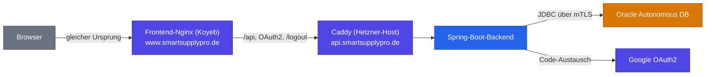

# Backend-Architektur

Das Backend von Smart Supply Pro ist ein Spring-Boot-Dienst für Lieferantenbeziehungen,
Bestandsverfolgung und Bestandsanalysen. Es stellt dem React-Frontend eine REST-API
bereit, hält seine Daten in der Oracle Autonomous Database und meldet Benutzer über
Google an.

> **Dies ist eine Zusammenfassung der arc42-Dokumentation auf einer Seite.** Jeder
> Abschnitt verweist auf die Seite mit den Details und Begründungen: Die
> [vollständige Architekturdokumentation](index-de.html) umfasst Einführung und Ziele,
> Randbedingungen, Kontext, Bausteine, Laufzeit, Verteilung, Konzepte, Entscheidungen,
> Qualität, Risiken und Glossar.

## Kontext und Technologie

Der Browser spricht nie direkt mit dem Backend-Host. Er lädt das Frontend von
`www.smartsupplypro.de`; dessen Nginx liefert das Bundle aus und leitet `/api`, die
OAuth2-Pfade und `/logout` an `api.smartsupplypro.de` weiter. Dort beendet der Caddy
des gemeinsam genutzten Hetzner-Hosts TLS und reicht die Anfrage an den
Backend-Container weiter. Google ist der einzige Identitätsanbieter, die Oracle
Autonomous Database die einzige Produktionsdatenbank.

| Komponente | Technologie | Version |
|---|---|---|
| Sprache | Java | 21 |
| Framework | Spring Boot | 4 |
| Sicherheit | Spring Security, OAuth2-Client | 7 (von Boot verwaltet) |
| Datenbank | Oracle Autonomous Database (Produktion), H2 im Oracle-Modus (Tests) | 23ai |
| Build | Maven Wrapper | 3 |
| Tests | JUnit 6 (Jupiter), Mockito | von Boot verwaltet |

Details: [§2 Randbedingungen](02-constraints.md), [§3 Kontext](03-context.md).

## Bausteine

Anfragen durchlaufen vier Schichten. Controller leiten weiter, validieren das
eingehende DTO (`@Valid`) und tragen die Berechtigungsregel (`@PreAuthorize`);
Services enthalten die Geschäftsregeln und die Transaktionen; Repositories speichern,
mit eigenen Fragmenten für das Analyse-SQL. Entitäten verlassen die Service-Schicht
nie, und DTOs erreichen die Repositories nie. Die Abbildung zwischen beiden ist
schlichtes Java, ohne Generator.

Details: [§5 Bausteinsicht](05-building-blocks.md),
[ADR-0002](09-decisions/adr-0002-manual-mapping-over-mapstruct.md),
[ADR-0003](09-decisions/adr-0003-dto-boundary-no-entity-exposure.md).

## Sicherheit

- **Anmeldung.** Das Backend führt den Authorization-Code-Flow von Google selbst aus;
  der Browser hält nie ein Token. Nur E-Mail-Adressen auf der Freigabeliste können sich
  anmelden, und für alle anderen wird kein Konto angelegt
  ([ADR-0011](09-decisions/adr-0011-restrict-oauth2-login-to-allowlist.md)). Nach der
  Anmeldung führt das Backend eine Server-Session; ihr Cookie ist `HttpOnly`, `Secure`
  und `SameSite=Lax`.
- **Rollen.** `ADMIN` darf alles; `USER` darf lesen sowie Mengen und Preise anpassen.
  Jeder `/api`-Endpunkt außer Health und `/api/me` trägt eine ausdrückliche
  `@PreAuthorize`-Regel, und ein Vertragstest schlägt für einen Endpunkt ohne Regel fehl.
- **Demo-Modus.** Ist `app.demo-readonly` aktiv, darf ein anonymer Besucher die
  Demodaten lesen; jede Identität in einer Antwort wird durch ein Pseudonym ersetzt.
  Schreibzugriffe erfordern weiterhin einen angemeldeten `USER` oder `ADMIN`.

Details: [§8 Querschnittliche Konzepte](08-concepts.md),
[§6 Laufzeitsicht](06-runtime.md),
[ADR-0007](09-decisions/adr-0007-cross-origin-auth-cookie.md).

## Fehler

Der HTTP-Status trägt das Ergebnis. Jede Fehlerantwort, auch die 401 eines nicht
angemeldeten API-Aufrufs, hat dieselbe Form: ein Fehlerkürzel, eine Meldung und einen
Zeitstempel, dazu `fieldErrors`, wenn der Fehler ein Eingabefeld benennt. Meldungen
aus Ausnahmen werden bereinigt, bevor sie den Client erreichen; Stacktraces erreichen
ihn nie.

Details: [§8 Fehlerbehandlung](08-concepts.md),
[ADR-0004](09-decisions/adr-0004-http-status-as-envelope.md),
[ADR-0005](09-decisions/adr-0005-error-message-sanitization.md).

## Daten und Analysen

Oracle hält die Produktionsdaten; dort wendet Flyway die Schema-Migrationen an. Die
automatisierten Tests laufen auf H2 im Oracle-Kompatibilitätsmodus, weil die
Free-Tier-Datenbank nur freigegebene Adressen zulässt. Die Analyseabfragen liegen in
eigenen Repository-Fragmenten, ihr SQL in Builder-Klassen; wo H2 und Oracle sich
tatsächlich unterscheiden (Datumsgruppierung, Bewertung), hat jede Abfrage eine
Variante je Dialekt.

Details: [§8 Infrastruktur](08b-concepts-infra.md),
[ADR-0006](09-decisions/adr-0006-dialect-aware-analytics-queries.md).

## Verteilung

Das Backend läuft als ein Container auf einem gemeinsam genutzten Hetzner-Host. Ein
Merge nach `main` startet die Backend-CI; ist sie grün und betrifft die Änderung die
Anwendung, wird das Image gebaut, auf behebbare Schwachstellen der Stufen HIGH und
CRITICAL geprüft, in GHCR veröffentlicht und auf den Host ausgerollt, gefolgt von
einem Health-Check. Das Datenbank-Wallet und alle Zugangsdaten kommen beim Start aus
der Umgebungsdatei des Hosts, nie aus dem Image.

Details: [§7 Verteilungssicht](07-deployment.md),
[ADR-0009](09-decisions/adr-0009-runtime-wallet-delivery.md),
[ADR-0012](09-decisions/adr-0012-backend-hosting-on-shared-hetzner-host.md).

## Qualität und Tests

Unit-Tests prüfen Services und Validatoren ohne Spring; Web-Slice-Tests prüfen die
Controller mit ihren Sicherheitsregeln; Persistenztests führen jedes Repository gegen
H2 aus; einige Tests mit vollem Kontext prüfen den Start. Die Browser-Testsuite
prüft das Frontend gegen dieses Backend, gebaut aus demselben Commit, bevor etwas
ausgerollt wird. Der Abdeckungsbericht des letzten Builds auf `main` ist
veröffentlicht:
[Backend-Abdeckungsbericht](https://keglev.github.io/inventory-service/backend/coverage/index.html).

Details: [§8 Tests](08c-concepts-testing.md),
[§10 Qualitätsanforderungen](10-quality-requirements.md).

## Entscheidungen und Risiken

Jede wesentliche Entscheidung ist mit ihren Alternativen in den
[Architekturentscheidungen](09-decisions/index.md) festgehalten; bekannte Risiken,
akzeptierte technische Schulden und die Ausnahmen vom Größenbudget stehen in
[§11](11-risks-technical-debt.md).
