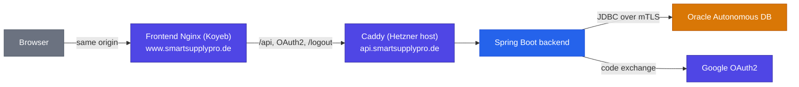

# Backend Architecture

Smart Supply Pro's backend is a Spring Boot service for supplier relationships,
inventory tracking and stock analytics. It serves a REST API to the React frontend,
keeps its data in Oracle Autonomous Database and signs users in through Google.

> **This is a one-page summary of the arc42 documentation.** Each section below
> points to the page that holds the detail and the reasons: the
> [full architecture documentation](index.html) covers introduction and goals,
> constraints, context, building blocks, runtime, deployment, concepts, decisions,
> quality, risks and the glossary.

## Context and technology

The browser never talks to the backend host directly. It loads the frontend from
`www.smartsupplypro.de`, whose Nginx serves the bundle and proxies `/api`, the OAuth2
paths and `/logout` to `api.smartsupplypro.de`; there, the shared Hetzner host's
Caddy terminates TLS and forwards to the backend container. Google is the only
identity provider; Oracle Autonomous Database is the only production database.

| Component | Technology | Version |
|---|---|---|
| Language | Java | 21 |
| Framework | Spring Boot | 4 |
| Security | Spring Security, OAuth2 client | 7 (Boot-managed) |
| Database | Oracle Autonomous Database (production), H2 in Oracle mode (tests) | 23ai |
| Build | Maven wrapper | 3 |
| Tests | JUnit 6 (Jupiter), Mockito | Boot-managed |

Details: [§2 Constraints](02-constraints.md), [§3 Context](03-context.md).

## Building blocks

Requests pass through four layers. Controllers route, validate the incoming DTO
(`@Valid`) and carry the authorization rule (`@PreAuthorize`); services hold the
business rules and the transactions; repositories persist, with custom fragments for
the analytics SQL; entities never leave the service layer, and DTOs never reach the
repositories. Mapping between them is plain Java, without a generator.

Details: [§5 Building Block View](05-building-blocks.md),
[ADR-0002](09-decisions/adr-0002-manual-mapping-over-mapstruct.md),
[ADR-0003](09-decisions/adr-0003-dto-boundary-no-entity-exposure.md).

## Security

- **Sign-in.** The backend runs Google's authorization-code flow itself; the browser
  never holds a token. Only e-mail addresses on the allow-list can sign in, and no
  account is created for anyone else
  ([ADR-0011](09-decisions/adr-0011-restrict-oauth2-login-to-allowlist.md)). After the
  login the backend keeps a server session; its cookie is `HttpOnly`, `Secure` and
  `SameSite=Lax`.
- **Roles.** `ADMIN` may do everything; `USER` may read and adjust quantities and
  prices. Every `/api` endpoint except health and `/api/me` carries an explicit
  `@PreAuthorize` rule, and a contract test fails for one that does not.
- **Demo mode.** With `app.demo-readonly` on, an anonymous visitor may read the demo
  data; every identity in a response is replaced by a pseudonym. Writes still need a
  signed-in `USER` or `ADMIN`.

Details: [§8 Concepts](08-concepts.md), [§6 Runtime View](06-runtime.md),
[ADR-0007](09-decisions/adr-0007-cross-origin-auth-cookie.md).

## Errors

The HTTP status carries the result. Every error answer, the 401 of an unauthenticated
API call included, has one shape: an error token, a message and a timestamp, plus
`fieldErrors` when the failure names an input. Messages that come from exceptions
are sanitised before they reach the client, and stack traces never do.

Details: [§8 Exception Handling](08-concepts.md),
[ADR-0004](09-decisions/adr-0004-http-status-as-envelope.md),
[ADR-0005](09-decisions/adr-0005-error-message-sanitization.md).

## Data and analytics

Oracle holds the production data; Flyway applies the schema migrations there. The automated tests run
on H2 in Oracle-compatibility mode, because the free-tier database admits only
allow-listed addresses. The analytics queries live in custom repository fragments with
their SQL in builder classes; where H2 and Oracle really differ (date bucketing,
valuation), each query has a variant per dialect.

Details: [§8 Infrastructure](08b-concepts-infra.md),
[ADR-0006](09-decisions/adr-0006-dialect-aware-analytics-queries.md).

## Deployment

The backend runs as one container on a shared Hetzner host. A merge to `main` runs the
backend CI; when it passes and the change touches the application, the image is built,
scanned for fixable HIGH or CRITICAL vulnerabilities, pushed to GHCR and released to the
host, followed by a health check. The database wallet and all credentials come from the
host's environment file at startup, never from the image.

Details: [§7 Deployment View](07-deployment.md),
[ADR-0009](09-decisions/adr-0009-runtime-wallet-delivery.md),
[ADR-0012](09-decisions/adr-0012-backend-hosting-on-shared-hetzner-host.md).

## Quality and testing

Unit tests cover services and validators without Spring; web-slice tests cover
controllers with their security rules; persistence tests run every repository against
H2; a few full-context tests check the boot. The browser suite runs the frontend
against this backend, built from the same commit, before anything is released. The
coverage report of the latest build on `main` is published:
[backend coverage report](https://keglev.github.io/inventory-service/backend/coverage/index.html).

Details: [§8 Testing](08c-concepts-testing.md),
[§10 Quality Requirements](10-quality-requirements.md).

## Decisions and risks

Every significant choice is recorded with its alternatives in the
[decision records](09-decisions/index.md); known risks, accepted technical debt and the
size-budget waivers are in [§11](11-risks-technical-debt.md).
