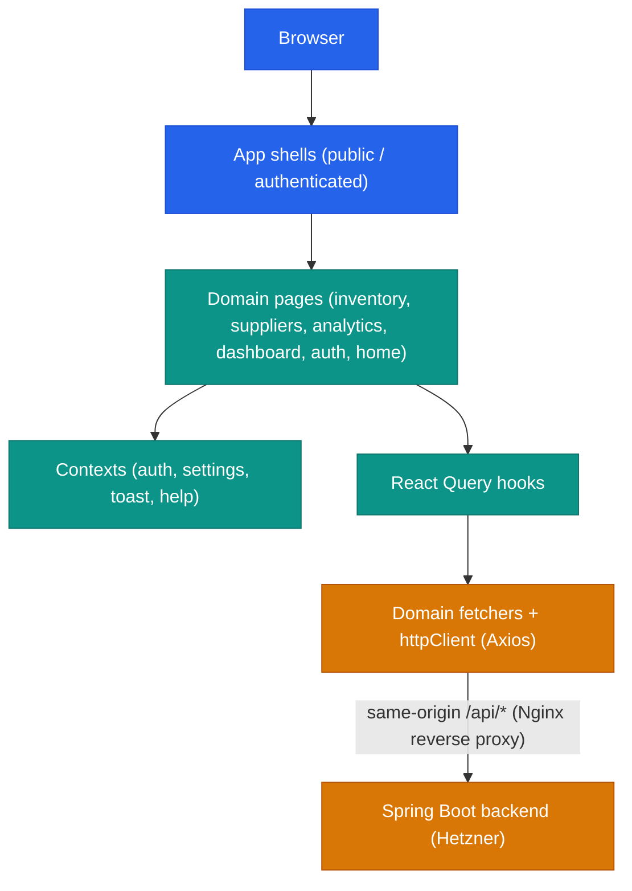

# Frontend Architecture

Smart Supply Pro's frontend is a React + TypeScript single-page application for
inventory management, supplier workflows, and purchasing analytics. The
architecture prioritises **predictable domain structure**, **typed data access**,
and **a German-first bilingual user experience**.

> **This is a one-page summary.** For the structured arc42 documentation —
> introduction and goals, constraints, context, building blocks, runtime,
> deployment, concepts, decisions, quality, risks, and glossary — see the
> [full architecture documentation](index.html).

## Technology stack

| Component      | Technology                    | Version |
|----------------|-------------------------------|---------|
| Framework      | React                         | 19      |
| Language       | TypeScript                    | 6       |
| Build tool     | Vite                          | 8       |
| UI library     | MUI (Material UI) + X Data Grid | 9 / 9 |
| Server state   | TanStack React Query          | 5       |
| Routing        | React Router                  | 7       |
| Forms          | React Hook Form + Zod         | 7 / 4   |
| i18n           | i18next + react-i18next       | 26 / 17 |
| Charts         | Recharts                      | 3       |
| HTTP client    | Axios                         | 1       |
| Testing        | Vitest + Testing Library; Playwright | 5 / 16; 1 |
| Runtime        | Node                          | >= 24   |

## Key architectural principles

1. **Feature-first structure** — one self-contained module per business domain under `src/pages/`
2. **Strict import direction** — pages never touch HTTP details; the API layer never imports UI
3. **One HTTP client** — a single Axios instance owns credentials, headers, timeouts, and central 401 handling
4. **Server state via React Query** — caching, retries, and invalidation live in query hooks, not components
5. **Context for global client state** — auth, settings, toast, and help, accessed through throwing hooks
6. **German-first i18n** — localStorage pre-seeded to `de` on first visit; no fallback strings in code
7. **Dialog-driven mutations** — create/edit/delete flows are isolated dialog containers per domain
8. **Testability** — Vitest suites across unit, component and routing-contract layers, plus a Playwright suite in CI; coverage thresholds gate every build ([report](https://keglev.github.io/inventory-service/frontend/coverage/index.html))

## System architecture



## Domains

Each business area is a self-contained module with the same orchestrator shape:
a board component composing state hooks, handler hooks, query hooks,
presentational components, and dialog containers.

| Domain | Responsibility |
|---|---|
| Inventory | Item CRUD, quantity adjustment, price changes, stock reasons |
| Suppliers | Supplier CRUD, search by typing, paged list; delete refused while any item references the supplier |
| Analytics | Chart/table blocks, filters with URL sync; an empty supplier filter means all suppliers |
| Dashboard | KPI cards, movement mini-chart, navigation hub |
| Auth | Login, OAuth callback + session hydration, demo entry, logout |
| Home | Public landing flow and demo entry point |

## Authentication and session model

Session-based OAuth2 (Google) handled by the backend — the SPA holds no tokens.
The auth context hydrates from `GET /api/me`. **Demo mode** is a client-side
session (kept in localStorage) with no backend account: its reads reach the backend
anonymously and are admitted by `app.demo-readonly`, and every dialog stops a write
before the request ([ADR-0013](09-decisions/adr-0013-demo-mode-blocks-only-the-write.md)). Unauthorized responses are handled centrally by the Axios interceptor, with
three exemptions (public pages, the `/api/me` probe, demo sessions).

## Internationalization

Full English/German localization with runtime-loaded JSON namespaces, compile-time
typed keys (`resources.d.ts`, from the English JSON) and no fallback strings in code;
every key exists in both locale files. First visit renders German by design, and a
key missing at runtime falls back to German.

## Deployment

The production build is served by **Nginx on Koyeb**. Browser traffic is
**same-origin**: Nginx rewrites the baked API base to the frontend host at serve
time and reverse-proxies `/api/*` and the OAuth paths to the backend at `api.smartsupplypro.de`
(canonical record: backend ADR-0008).

```
Merge to main
  → frontend-ci.yml       audit, lint, Vitest suite, Playwright suite; image build,
                          SBOM and CVE gate, push to Docker Hub
  → frontend-deploy.yml   deploy that image to Koyeb by digest, verify the served
                          bundle carries the commit
```

## Testing

- **Unit tests** — hooks, utilities, API fetchers, and client policies
- **Component tests** — Testing Library rendering with i18n + provider harnesses
- **Routing-contract tests** — guard behavior, redirects, and route surface

Coverage and taxonomy conventions are documented in
[§8c Testing Concepts](08c-concepts-testing.md) and
[ADR-0008](09-decisions/adr-0008-testing-structure-and-taxonomy.md).
